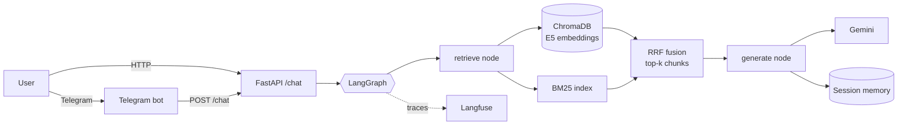

# Ragbot: RAG Assistant for Web & API Standards (IETF RFCs)

[](https://github.com/tomaskurtenperez/ragbot/actions/workflows/deploy.yml)


Ragbot is a Retrieval-Augmented Generation (RAG) service that answers developer questions
about the IETF standards behind web APIs: HTTP semantics and caching, Problem Details,
JSON, OAuth 2.0 and JWT. It exposes a REST API (FastAPI) and a Telegram bot client. It is
containerized with Docker and deployed to AWS through a GitHub Actions CI/CD pipeline.

Answers come only from the indexed RFCs and keep their normative keywords
(MUST / SHOULD / MAY) and section references. When the documents don't cover a question,
the assistant says so instead of making up an answer.

## Highlights

- **Hybrid retrieval**: dense semantic search with `intfloat/multilingual-e5-base`
  embeddings in ChromaDB, combined with lexical BM25 search. The two rankings are merged
  with **Reciprocal Rank Fusion (RRF)**. BM25 catches exact identifiers such as
  `Cache-Control`, `invalid_grant` or `412`, and embeddings handle paraphrased questions.
- **Structure-aware ingestion**: RFCs are split by their numbered sections, and each
  section is then chunked with `RecursiveCharacterTextSplitter` (1000 chars, 150 overlap).
  Every chunk carries its section (e.g. `8.8.3. ETag`) as metadata, so the model can
  cite it. Page headers, footers and the table of contents are removed. PDFs are also
  supported (split per page). Chunk IDs are deterministic (SHA-256), so re-indexing is
  idempotent.
- **Conversational memory**: a LangGraph `StateGraph` (`retrieve → generate`) with a
  checkpointer keeps a bounded per-session history. This lets users ask follow-up
  questions.
- **Observability**: optional [Langfuse](https://langfuse.com) tracing of every request
  (retrieval, prompt, model output). Retrieval logs record which chunks matched and
  their scores.
- **Production-minded deployment**: a multi-stage Docker image with the vector index
  built at image build time. The embedding model runs offline at runtime. CI runs the
  tests, publishes the image to GHCR and deploys it to an AWS host over SSH.
- **Multilingual**: E5 embeddings let users ask in Spanish or other languages and still
  retrieve the English source text.

## Knowledge base

| Document | Topic |
|---|---|
| [RFC 9110](https://www.rfc-editor.org/rfc/rfc9110) | HTTP Semantics (methods, status codes, headers, conditional requests) |
| [RFC 9111](https://www.rfc-editor.org/rfc/rfc9111) | HTTP Caching |
| [RFC 9457](https://www.rfc-editor.org/rfc/rfc9457) | Problem Details for HTTP APIs |
| [RFC 8259](https://www.rfc-editor.org/rfc/rfc8259) | JSON |
| [RFC 6749](https://www.rfc-editor.org/rfc/rfc6749) | OAuth 2.0 Authorization Framework |
| [RFC 7519](https://www.rfc-editor.org/rfc/rfc7519) | JSON Web Token (JWT) |

The official plain-text versions are used instead of PDFs. In the PDF renderings, the
requirement keywords (MUST, SHOULD...) are drawn in a special font that PDF text
extraction drops, which would change the meaning of the requirements. The plain-text
format is the canonical one, has no images, and has a regular numbered structure that
is easy to chunk.

## Architecture



**Ingestion (offline / Docker build):** `RFC text → cleanup (page furniture, TOC) → split by
section → chunking with section metadata → E5 "passage:" embeddings → ChromaDB`

## Tech stack

| Area | Tools |
|---|---|
| API | FastAPI, Pydantic, Uvicorn |
| Orchestration | LangGraph |
| LLM | Google Gemini (`google-genai`) |
| Embeddings | Sentence-Transformers, `intfloat/multilingual-e5-base` |
| Retrieval | ChromaDB (vector), `rank_bm25` (lexical), Reciprocal Rank Fusion |
| Document processing | Section-aware RFC parser, pypdf, LangChain text splitters |
| Observability | Langfuse, structured logging |
| Client | python-telegram-bot, httpx |
| DevOps | Docker (multi-stage), GitHub Actions, GHCR, AWS |

## Project structure

```
app/
  api/chat.py                 # /chat and /health endpoints
  core/config.py              # Environment-based configuration
  core/prompts.py             # Grounded-answer prompt template
  db/vector_db.py             # Chroma + BM25 hybrid search with RRF
  schemas/chat.py             # Request/response models
  services/
    document_splitter.py      # RFC/text and PDF parsing, cleanup, section-aware chunking
    embedding_service.py      # Local E5 embedding model (thread-safe, offline)
    llm_service.py            # Gemini generation
    rag_service.py            # LangGraph pipeline + Langfuse tracing
    retrieval_service.py
scripts/
  ingest.py                   # Builds the Chroma index from data/documents
  preview_chunks.py           # Inspect how documents are chunked
  telegram_bot.py             # Telegram client for the API
tests/                        # Offline API and splitter tests + opt-in online test
data/documents/               # Knowledge base (IETF RFCs, plain text)
```

## Getting started

### Prerequisites

- Python 3.12
- A [Gemini API key](https://aistudio.google.com/apikey)

### Local setup

```bash
python -m venv .venv
source .venv/bin/activate          # Windows: .venv\Scripts\activate
pip install --index-url https://download.pytorch.org/whl/cpu torch
pip install -r requirements.txt

cp .env.example .env               # then set GEMINI_API_KEY

# Download the embedding model once (the app loads it offline afterwards)
python -c "from huggingface_hub import snapshot_download; snapshot_download('intfloat/multilingual-e5-base')"

# Build the vector index from the documents in data/documents
python -m scripts.ingest

# Run the API
uvicorn app.main:app --reload
```

Interactive docs are available at http://127.0.0.1:8000/docs.

### Example request

```bash
curl -X POST http://127.0.0.1:8000/chat \
  -H "Content-Type: application/json" \
  -d '{"question": "When should a server respond with 304 Not Modified?"}'
```

```json
{
  "answer": "A server sends 304 Not Modified when a conditional GET or HEAD ...",
  "session_id": "3f9c..."
}
```

To ask a follow-up question in the same conversation, send the returned `session_id`
with the next request.

### Telegram bot

Set `TELEGRAM_BOT_TOKEN` and `RAGBOT_API_URL` in `.env`, then run:

```bash
python -m scripts.telegram_bot
```

Commands: `/start` and `/new` (starts a fresh conversation).

### Docker

The image builds the Chroma index during `docker build`. At runtime it reads the
embedding model from the host's Hugging Face cache:

```bash
docker build -t ragbot-api .
docker run --env-file .env -p 8000:8000 \
  -v ~/.cache/huggingface:/root/.cache/huggingface:ro \
  ragbot-api
```

## Configuration

| Variable | Default | Description |
|---|---|---|
| `GEMINI_API_KEY` | (none, required) | Google Gemini API key |
| `GEMINI_MODEL` | `gemini-3.5-flash-lite` | Generation model |
| `GEMINI_MAX_OUTPUT_TOKENS` | `1024` | Max answer length |
| `HF_EMBEDDING_MODEL` | `intfloat/multilingual-e5-base` | Embedding model (Hub id or local path) |
| `CHROMA_COLLECTION_NAME` | `documents` | Chroma collection |
| `CHROMA_DB_PATH` | `data/chroma_db` | Vector store location |
| `LANGFUSE_PUBLIC_KEY` / `LANGFUSE_SECRET_KEY` | (none) | Enables tracing when both are set |
| `TELEGRAM_BOT_TOKEN` | (none) | Telegram bot only |
| `RAGBOT_API_URL` | `http://127.0.0.1:8000` | API URL used by the Telegram bot |

## Testing

```bash
# Offline tests (retrieval and LLM are mocked; these run in CI)
python -m unittest discover -s tests -t . -v

# Opt-in end-to-end test against the real index and Gemini
RUN_ONLINE_RAG_TESTS=1 python -m unittest tests.test_chat_online -v
```

## CI/CD

On every push and pull request, [`.github/workflows/deploy.yml`](.github/workflows/deploy.yml)
does the following:

1. Runs the offline test suite.
2. Builds the multi-stage Docker image. The build downloads the embedding model and
   indexes the RFCs.
3. On `main` only, pushes the image to GitHub Container Registry. It then deploys over
   SSH to an AWS host: it checks that the index is not empty, then restarts the
   container. All credentials come from GitHub Actions secrets.

## Possible improvements

- Return source citations (RFC and section) as structured data in the API response. The
  metadata is already stored with each chunk.
- Add a cross-encoder re-ranker after RRF fusion.
- Persist conversation memory (Redis or Postgres) instead of in-process memory.
- Add a retrieval evaluation set (hit rate / MRR) and an answer-quality evaluation in CI.

## Data

The indexed documents are IETF RFCs, redistributed unmodified and in full under the
[IETF Trust Legal Provisions](https://trustee.ietf.org/documents/trust-legal-provisions/).

## License

Code released under the [MIT License](LICENSE). The RFC documents keep their own IETF Trust terms (see [Data](#data)).
